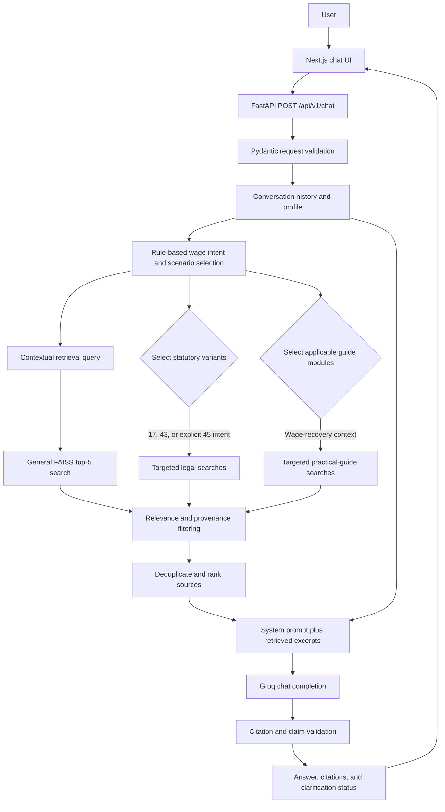
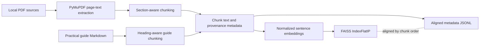

# LegalAssist AI

**An India-focused, source-grounded conversational assistant for employment wage rights.**

LegalAssist AI explores how an assistant can answer common wage-related questions using a local, traceable source collection rather than relying on model knowledge alone. The prototype combines a FastAPI retrieval and validation service with a Next.js chat interface, FAISS similarity search, and Groq-backed generation.

The project is intentionally scoped to information about delayed or unpaid wages, wage deductions, overtime, and wage-related questions after employment ends. It does not determine a user's legal rights or replace professional advice.

**Technology:** Python · FastAPI · Sentence Transformers · FAISS · Groq · Next.js · TypeScript

## Contents

- [Problem statement](#problem-statement)
- [Project scope](#project-scope)
- [Key features](#key-features)
- [Application architecture](#application-architecture)
- [Development process](#development-process)
- [RAG pipeline](#rag-pipeline-in-detail)
- [Knowledge sources](#knowledge-sources-and-source-hierarchy)
- [Technology stack](#technology-stack)
- [Project structure](#project-structure)
- [Local installation and execution](#local-installation-and-execution)
- [API reference](#api-reference)
- [Testing and evaluation](#testing-and-evaluation)
- [Limitations](#limitations)
- [Future improvements](#future-improvements)
- [Disclaimer](#disclaimer)

## Problem statement

People dealing with late or missing pay often need clear, practical information about what to check and which source supports a legal statement. Relevant questions can involve:

- Delayed monthly salary or unpaid wages.
- Wage amounts still outstanding after resignation or termination.
- Overtime compensation.
- Deductions from wages.
- An employer not responding to a written wage request.

A generic LLM response is not enough for this setting. Legal claims should be traceable to a source; legislation, delegated rules, official explanations, and informal practical material do not have the same authority. The relevant provision or guidance can also depend on the user's circumstances and the intent of a follow-up question. The application therefore retrieves source excerpts and metadata, selects context-specific material, and applies rule-based checks before returning an answer.

## Project scope

LegalAssist AI is a conversational prototype for Indian employment wage-related information in the local knowledge base. It covers delayed and unpaid wages, deductions, overtime, and certain wage-recovery scenarios after resignation or termination. It can provide cautious practical suggestions from a separately labelled guide.

The prototype is not:

- A lawyer, legal representative, or substitute for qualified legal advice.
- A system for issuing legal notices or generating legal documents.
- A comprehensive guide to every Indian labour law or State-specific employment rule.
- A source of guaranteed legal outcomes or case-specific legal determinations.

State rules and applicability details may be missing. In particular, Central Rules must not be assumed to apply to every establishment.

## Key features

- **Conversation-aware chat:** The frontend sends the conversation history. The backend uses recent messages to contextualize recognized follow-ups while retaining the current user wording for generation.
- **Local source retrieval:** The service searches the existing FAISS index using normalized `BAAI/bge-small-en-v1.5` embeddings and preserves the originating chunk's metadata.
- **Intent-specific retrieval:** Wage-payment timing, employer responsibility, and explicit claims or authority questions can select different statutory query variants. Generic requests for next steps do not by themselves select Section 45.
- **Scenario-aware practical material:** The wage-recovery selector distinguishes ordinary delayed salary, resignation, termination, and employer non-response. It only includes the corresponding modules when the conversation supports that scenario.
- **Visible source provenance:** Answers include inline citations. An expandable Sources panel displays source type, authority, review status, identifiers, and page or guide heading details.
- **Rule-based answer safeguards:** Citation-to-source matching, section checks, legal-assertion checks, and unsupported-claim guards help reject some unsupported output. These checks are safeguards, not proof of semantic entailment.
- **Explicit clarification and errors:** The API validates message roles and lengths, can return a follow-up question, maps known model errors to controlled HTTP responses, and logs unexpected server failures without returning their details to the user.

## Application architecture

The chat service runs general retrieval first. When the contextual query expresses a recognized wage intent, it also runs targeted statutory and scenario-selected practical-guide searches. Results are filtered and merged before being formatted into the generation prompt.



The document ingestion path is separate from request-time retrieval:



## Development process

The implementation is organized as a sequence of engineering decisions reflected in the current code and artifacts, rather than as a tutorial chatbot wrapper.

### 1. Define the wage-rights scope and source set

- **Objective:** Keep the application focused on a bounded class of employment wage questions.
- **Implementation:** The source manifest identifies the Code on Wages, 2019; the Code on Wages (Central) Rules, 2026; Labour Codes FAQs from January 2026; and additional FAQs dated 16 March 2026. A separate practical guide is marked as supplementary.
- **Decision:** Preserve source type, publisher, jurisdiction, government sphere, effective-status notes, and verification state. The API must not treat a government FAQ or an informal guide as having the same authority as legislation.
- **Result:** Retrieval records carry provenance that can be shown to the user and used by source filters.

The manifest also lists a commencement notification as an external reference that is **not locally ingested**. The project does not treat that reference as an indexed source.

### 2. Extract PDF text and track source files

- **Objective:** Convert local official PDFs into page-addressable text without losing page references.
- **Implementation:** `backend/app/rag/extract.py` uses PyMuPDF (`fitz`) to call `page.get_text("text")` and emits JSONL page records. Ingestion scripts write the source manifest and SHA-256 checksums.
- **Decision:** Keep extraction deterministic and make sparse or empty PDF pages visible for manual review. OCR is not implemented.
- **Result:** Extracted text retains the source ID, document title, and page number for subsequent chunking.

The raw PDF pattern is ignored by `.gitignore`; a local copy of those PDFs may be needed to repeat extraction. The processed chunks and current index artifacts are stored separately under `knowledge_base/processed/`.

### 3. Chunk content while preserving legal boundaries and metadata

- **Objective:** Make source text searchable without losing the location or provenance needed for a citation.
- **Implementation:** `backend/app/rag/chunk.py` normalizes whitespace, respects logical blocks and statutory section headings, and uses a default target of 3,500 characters with 400 characters of overlap. `backend/app/rag/practical_guide.py` chunks the guide by Markdown heading and uses a 1,600-character target.
- **Decision:** Carry fields such as `chunk_id`, `source_id`, `document_title`, filename, page and section, source URL, source type, authority level, verification status, guide module, heading path, claim IDs, and unresolved references where available.
- **Result:** Citations can identify a legal page/section or a practical-guide module/heading instead of pointing only to an opaque vector result.

### 4. Embed chunks and build the FAISS index

- **Objective:** Search a local knowledge base by semantic similarity.
- **Implementation:** `backend/app/rag/embed.py` uses `BAAI/bge-small-en-v1.5` to produce 384-dimensional embeddings and normalizes vectors. `build_index.py` stores them in a FAISS `IndexFlatIP` index alongside aligned `metadata.jsonl` rows.
- **Decision:** Inner product over normalized vectors provides cosine-similarity ranking; a flat index performs exact search for this local corpus. A fingerprint in `index_info.json` allows the builder to reuse an index when its inputs and embedding configuration match.
- **Result:** The current index metadata reports 266 chunks and 266 vectors. The reported count describes the present index snapshot, not a quality or coverage metric.

### 5. Add scenario-aware, conversation-contextual retrieval

- **Objective:** Resolve short follow-ups against the established wage issue and retrieve provisions that match the user's expressed intent.
- **Implementation:** `build_retrieval_query()` combines the current follow-up with relevant recent user messages. Rule-based selectors identify wage-payment timing, employer responsibility, and explicit wage-claim or appointed-authority intent. General search is supplemented with targeted Section 17, 43, or 45 variants as appropriate.
- **Decision:** Section 17 is selected for relevant wage-payment timing or unpaid-wage queries; Section 43 for employer-responsibility questions; and Section 45 only for specific claims, filing, appointed-authority, or escalation intent. A generic “What should I do?” does not itself select Section 45.
- **Result:** Relevant context can drive retrieval without rewriting the original current message passed to generation. Section text and provenance are checked before targeted sources are retained.

### 6. Integrate practical guidance without promoting its authority

- **Objective:** Support useful non-legal next-step suggestions when the available guide is relevant.
- **Implementation:** The Markdown guide is chunked with module and heading metadata. In the wage-recovery selector, `PRACTICAL-01` covers delayed monthly salary; `PRACTICAL-02` is selected for established resignation scenarios; `PRACTICAL-06` for termination/separation scenarios; and `PRACTICAL-05` when employer non-response is relevant.
- **Decision:** Keep the guide as `practical_guidance`, `non_authoritative`, and `pending_human_review`. Its excerpts may support cautious practical recommendations, but not a statutory right, legal remedy, deadline, or procedure.
- **Result:** The UI and citations retain module, section heading, claim references, unresolved references, and review status. The four companion research/review files declared by the guide are not present, so those references cannot be independently checked from the companion files.

### 7. Generate a response from the retrieved context

- **Objective:** Explain retrieved information conversationally while retaining the user's conversation context.
- **Implementation:** `backend/app/rag/chat_service.py` calls the Groq Python SDK with a system message containing runtime instructions and formatted retrieved excerpts, followed by up to the configured number of chronological conversation messages. The default model is `openai/gpt-oss-20b`.
- **Decision:** Retrieval-query construction and generation history are separate: the contextual retrieval query does not replace the original latest user message. The model receives source labels and provenance along with excerpts.
- **Result:** The service can produce conversational answers or ask a concise follow-up when relevant facts are missing. Generation is not guaranteed to be hallucination-free.

The active runtime instructions are the `SYSTEM_PROMPT` constant in `backend/app/rag/chat_service.py`. `backend/app/prompts/system_prompt.txt` is present but is not currently loaded by the chat service.

### 8. Validate citations and constrain unsupported claims

- **Objective:** Reject responses whose legal claims or citations do not match retrieved evidence.
- **Implementation:** The service matches inline legal citations to retrieved document, section, and page metadata; practical citations to document, module, and heading; and applies section/provision checks and sentence-level legal-assertion categories. Phrase-based unsupported-claim checks and a grounded fallback add further controls.
- **Decision:** Legal assertions require suitable authoritative evidence. Practical guidance alone cannot support legal rights, deadlines, remedies, authorities, or statutory procedures. Missing or conflicting source metadata is treated conservatively. `needs_review` sources are not described as independently verified.
- **Result:** Some unsupported model output can be rejected or replaced with a limitation response. These rule-based checks are not a complete semantic proof that every sentence is entailed by its cited text.

### 9. Expose the service through an API and chat UI

- **Objective:** Separate user interaction from retrieval and generation.
- **Implementation:** FastAPI exposes the chat route and Pydantic request/response models. The Next.js/React frontend sends role-tagged conversation messages, renders answers, follow-up questions, and expandable source cards, and normalizes API errors for display.
- **Decision:** The API validates role order, message limits, and optional profile fields. It is the boundary for backend errors and source metadata, while the frontend focuses on interaction and disclosure.
- **Result:** The browser does not need direct access to the FAISS implementation or Groq credentials. The UI shows source type, authority, verification state, and available page or guide references.

### 10. Test and debug behavior as the pipeline evolved

- **Objective:** Catch regressions in extraction, retrieval, conversation context, citations, and API behavior.
- **Implementation:** Pytest covers PDF extraction, chunk boundaries and metadata, vector index handling, wage intent and scenario selection, citation support, unsupported claims, API behavior, and CORS. Frontend API tests use Node's built-in test runner; TypeScript has a separate typecheck.
- **Decision:** Use mocked Groq responses for deterministic service tests and add targeted regression cases for observed short-follow-up and source-selection failures.
- **Result:** The suite checks code behavior and selected retrieval expectations. It does not independently establish legal correctness or measure general model accuracy.

## RAG pipeline in detail

| Component | Implementation | Purpose |
|---|---|---|
| PDF extraction | PyMuPDF page text extraction | Preserve page-addressable local document text; no OCR |
| Official-source chunking | Python section/logical-block splitting; 3,500-character target and 400-character overlap | Keep relevant provisions together and retain page/section metadata |
| Guide chunking | Markdown heading-aware chunking; 1,600-character target | Preserve practical module, heading path, claim IDs, and unresolved references |
| Embedding | Sentence Transformers, `BAAI/bge-small-en-v1.5`, 384 dimensions | Encode chunks and queries in a shared vector space |
| Vector index | FAISS CPU `IndexFlatIP`; normalized vectors | Perform exact inner-product search equivalent to cosine ranking for normalized vectors |
| Retrieval | General top-five search plus intent-selected statutory and guide query variants | Retrieve broad context and targeted relevant material |
| Filtering and ranking | Source-text checks, provenance checks, chunk-ID deduplication, authority-aware merge | Exclude unsupported/scenario-mismatched sources and preserve relevant source metadata |
| Generation | Groq Python SDK; default `openai/gpt-oss-20b` | Produce a concise response using the system prompt, excerpts, and conversation history |
| Citation validation | Rule-based source matching and legal-assertion checks | Reject some mismatched citations and unsupported legal or procedural claims |

The chat service uses the configured `SIMILARITY_THRESHOLD` (default `0.30`) and requests up to five items per retrieval query. The lower-level `retrieve_top_k()` helper has its own default threshold (`0.2`); the chat service passes its configured value explicitly.

## Knowledge sources and source hierarchy

The source manifest distinguishes the following local source records:

| Source | Source type | Authority level | Verification status | Use |
|---|---|---|---|---|
| Code on Wages, 2019 | `primary_legislation` | `statutory` | `needs_review` | Primary legal text for supported wage provisions |
| Code on Wages (Central) Rules, 2026 | `delegated_rules` | `delegated_rules` | `needs_review` | Rules considered only where relevant and applicable; Central Rules are not assumed to apply to every establishment |
| Ministry of Labour FAQs, January 2026; Additional FAQs as of 16 March 2026 | `official_faq` | `official_guidance` | `needs_review` | Explanatory government material, subordinate to legislation and applicable rules |
| Employment Wage Rights – Practical Action Guide for Employees in India | `practical_guidance` | `non_authoritative` | `pending_human_review` | Supplementary, cautious non-legal suggestions only |

The local source manifest also lists a 2025 commencement notification as an external reference that is not locally ingested. It is not part of the current FAISS corpus.

The guide is not legislation or official government guidance. Its citations, claim IDs, and unresolved references do not establish settled law. Some official-source records also remain `needs_review`; the presence of a citation does not mean independent legal verification has been completed.

## Technology stack

| Technology | Usage |
|---|---|
| Python | Backend and document/retrieval pipeline |
| FastAPI, Uvicorn | HTTP API and local ASGI server |
| Pydantic, `pydantic-settings` | Request/response validation and configuration |
| Groq Python SDK | Chat-completion API |
| Sentence Transformers | Local text embeddings |
| `BAAI/bge-small-en-v1.5` | Default embedding model |
| FAISS CPU | Local flat inner-product vector index |
| PyMuPDF (`pymupdf`) | PDF page-text extraction |
| NumPy | Embedding normalization and vector operations |
| Next.js, React, TypeScript | Chat interface and API client |
| Node.js built-in `node:test` | Frontend API-client tests |
| Pytest, HTTPX | Backend tests and API test client |

The current frontend uses custom CSS in `frontend/app/globals.css`; Tailwind CSS and LangChain are not part of the implementation.

## Project structure

```text
.
├── backend/
│   ├── app/
│   │   ├── api/routes/       # Chat and health endpoints
│   │   ├── core/             # Settings
│   │   ├── prompts/          # Prompt text file (not runtime source)
│   │   ├── rag/              # Extraction, chunking, indexing, retrieval, chat
│   │   ├── schemas/           # Pydantic chat models
│   │   └── services/          # Legacy placeholders; not used by the active route
│   ├── scripts/               # Ingestion and evaluation scripts
│   ├── tests/                 # Backend regression and component tests
│   └── requirements.txt
├── frontend/
│   ├── app/                   # Next.js page, layout, and CSS
│   ├── lib/                   # API client and its tests
│   └── package.json
├── knowledge_base/
│   ├── raw/                   # Practical guide; source PDFs are local/ignored
│   ├── extracted/             # Page-level extracted JSONL
│   ├── processed/             # Chunks, reports, and vector store
│   ├── source_manifest.json
│   └── source_checksums.json
├── evaluation/                # Test cases and retrieval/conversation artifacts
├── .gitignore
└── README.md
```

The active chat pipeline is implemented in `backend/app/rag/` and called by `backend/app/api/routes/chat.py`. The `backend/app/services/` modules are placeholders and are not the runtime RAG services.

## Local installation and execution

The repository includes a processed chunk set and FAISS vector-store artifacts. Raw PDFs are ignored by `.gitignore` and may need to be supplied locally if you want to repeat PDF extraction or rebuild the knowledge base.

### Backend

From the repository root in PowerShell:

```powershell
py -m venv .venv
.\.venv\Scripts\Activate.ps1
python -m pip install --upgrade pip
python -m pip install -r backend\requirements.txt
Copy-Item backend\.env.example backend\.env
```

Edit `backend\.env` and set a valid `GROQ_API_KEY`. The example file also documents model, embedding, retrieval threshold, history-length, generation, and CORS settings. Do not commit `.env` files or place credentials in frontend configuration.

Start the backend in a terminal with the virtual environment active:

```powershell
Set-Location backend
python -m uvicorn app.main:app --reload --port 8000
```

The API is available at `http://127.0.0.1:8000`; interactive API documentation is at `http://127.0.0.1:8000/docs`, and the health endpoint is `http://127.0.0.1:8000/health`.

### Frontend

In a second terminal:

```powershell
Set-Location frontend
npm install
Copy-Item .env.example .env.local
npm run dev -- --port 3001
```

Open `http://localhost:3001`. `NEXT_PUBLIC_API_BASE_URL` defaults in the API client to `http://127.0.0.1:8000`; `frontend/.env.example` contains that same local URL. The backend's default CORS configuration allows the frontend's local port.

The Sentence Transformers model is loaded locally by the backend and may need to be downloaded into its model cache on first use.

## API reference

### `POST /api/v1/chat`

The request body requires `messages`. Each message has a `role` of `user` or `assistant` and non-empty `content` up to 8,000 characters. There must be at least one user message, and the final message must be from the user. The list supports up to 50 messages.

An optional `profile` may include `state`, `industry`, `employer_type`, `employment_type`, and `wage_period`. These are user-provided context, not verified facts.

```json
{
  "messages": [
    {
      "role": "user",
      "content": "My salary has not been paid for two months. What information should I keep?"
    }
  ],
  "profile": {
    "state": "Maharashtra",
    "employment_type": "monthly salaried"
  }
}
```

The response contains `answer`, `citations`, `sources`, `needs_clarification`, `clarification_needed`, `follow_up_question`, and `scope_note`. `sources` mirrors the citation list for compatibility. Citation entries may include `chunk_id`, `source_id`, `source_filename`, `document_title`, `source_type`, `authority_level`, `section`/`section_number`, page fields, practical module and heading fields, `source_url`, `verification_status`, `claim_ids`, `unresolved_refs`, and `excerpt`.

Common error responses include `422` for request validation, `503` when required service configuration or the knowledge base is unavailable, `429` for a model rate limit, `502`/`504` for upstream failures, and a sanitized `500` for an unexpected server error.

### `GET /api/v1/sources`

Returns unique source-level metadata from the loaded vector store, including source ID, title, source type, jurisdiction, source URL, and verification status.

### Other endpoints

- `GET /health` returns the API health response.
- `GET /` returns the service name and online status.
- `GET /docs` serves FastAPI's interactive OpenAPI documentation.

## Testing and evaluation

### Automated tests

Run the backend and frontend checks from the repository root:

```powershell
.\.venv\Scripts\python.exe -m pytest backend\tests -q
npm --prefix frontend test
npm --prefix frontend run typecheck
```

The backend tests cover PDF extraction, section-aware chunking, vector metadata and retrieval, chat history and follow-ups, statutory-section selection, practical-guide scenarios, citation matching, unsupported legal claims, API error behavior, and CORS. Frontend tests exercise API error normalization and request serialization. Typechecking is separate from the Node test runner.

These are software behavior checks. Passing tests do not establish the accuracy, applicability, or completeness of a legal interpretation.

### Retrieval and conversation artifacts

- `evaluation/test_cases.json` contains ten representative wage-rights and scope-control prompts.
- `evaluation/phase4_retrieval_results.json` and `evaluation/phase5_practical_guide_retrieval_results.json` contain ranked retrieval snapshots for four recurring query themes, including chunk IDs, similarity scores, sections/pages, and text previews. The Phase 5 snapshot includes the practical guide where it was retrieved.
- `backend/scripts/run_retrieval_tests.py` defines four expected-provision cases and checks for substantive section text in the top five. When run, it computes Hit@K and mean reciprocal rank for that small set and writes to `evaluation/phase5_practical_guide_retrieval_results.json`, replacing that file.
- `backend/scripts/run_phase5_manual_test.py` sends two conversations to the configured live Groq service and writes results under `evaluation/phase5_conversation_outputs/`. It requires a working API key, uses API quota, and overwrites the corresponding conversation output files.

The checked-in result snapshots are not model-accuracy or legal-correctness metrics. `evaluation/evaluation_notes.md` describes an earlier planning stage and does not reflect the current implemented pipeline.

## Limitations

- Several official-source records are marked `needs_review`; the application does not independently establish their legal status or completeness.
- The practical guide remains `pending_human_review`, and its declared companion research and review files are absent.
- The source collection is limited. State-specific rules, commencement/applicability material, and establishment-specific analysis may be missing.
- The Central Rules are not automatically applicable to every establishment.
- Follow-up, scenario, and statutory intent selection are rule-based; uncommon, multilingual, or differently phrased questions may not match the patterns.
- Citation and legal-assertion validation are rule-based checks, not semantic entailment verification.
- Groq generation depends on an external API and can be rate-limited or unavailable.
- The project is a local prototype; it has no production deployment or user-authentication flow.
- `backend/app/prompts/system_prompt.txt` is not currently the runtime prompt source; the active prompt is embedded in `chat_service.py`.

## Future improvements

- Obtain independent human/legal review for the practical guide and resolve its missing companion references.
- Expand the indexed source set for State-specific and applicability questions.
- Add broader multilingual, informal-language, and conversation-chain retrieval cases.
- Grow the retrieval evaluation set and keep generated snapshots separate from tracked baselines.
- Improve semantic evidence-support checks while retaining fail-closed legal safeguards.
- Consolidate the runtime prompt and prompt file into one maintained source.
- Add end-to-end testing against a controlled model stub and a reproducible local index fixture.

## Disclaimer

LegalAssist AI is an experimental informational prototype. It is not legal advice, legal representation, or a substitute for consulting a qualified legal professional. Verify important questions with appropriate official sources and qualified counsel.
